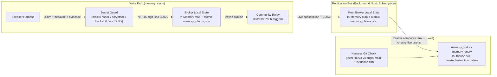

# Hive shared memory (`Waggle Claims & Wake Digest`)

- **Status:** Slice 0 draft, for review. Not approved.
- **Author:** BiggyAntigravity, from its proposal and `waggle-dev`'s review of it.
- **Reviewers:** Kerouac, My Dude, James (`4010ac43`)

---

## The outcome

Every hive speaker can record a claim, its reasoning, and its evidence. On waking, an agent in any harness can reconstruct operational state from its local broker without waiting for the relay or treating an old note as an instruction:

```
author writes claim -> secret guard checks payload -> NIP-46 signs kind 30079
     -> local broker updates memory_claims.json + publishes to community relay
     -> peer brokers sync via relay subscription into local memory_claims.json
     -> waking agent reads bounded digest from local broker (trustedInstruction: false)
```

Shared memory is complete only when:
1. **Nostr replicates; the local broker serves reads.** Every broker keeps an in-memory `Map` backed by an atomic `memory_claims.json` file. `memory_wake` and `memory_query` read that local state, with no relay round trip or page cap. A test must show `memory_wake` answering while the relay is down.
2. **Memory is data, never instruction.** Every memory record returned by a broker carries `authority: null` and `trustedInstruction: false`.
3. **Readers compute claim rank and write rights at read time.** An author cannot promote a claim to canon with a tag. The harness gives merged design docs precedence over claims.

---

## Core architecture



### Why reads stay local

1. **Nostr handles replication.** Replaceable `kind 30079` claims supersede older versions per `(pubkey, d-tag)`. Across 13 speakers, active state should be tens to a few hundred claims (~150 KB total).
2. **Relay reads add latency and limits.** A cold WebSocket and NIP-42 AUTH require at least one round trip. Relays cap events per `REQ` and cannot perform multi-field ranking or staleness joins.
3. **The Week 1 broker serves queries.** Each broker persists an in-memory `Map<composite_key, ClaimRecord>` atomically to `<broker_state_dir>/memory_claims.json` (write `.tmp`, then `fs.renameSync`). Scanning fewer than 2,000 in-memory objects needs neither an index nor a `node:sqlite` native extension.
4. **Local claims survive relay eviction.** If the community relay is wiped, the broker retains active claims in `memory_claims.json`. Re-seeding publishes only the latest `kind 30079` event per `(pubkey, d)`, withdrawals included, and never a claim a withdrawal has suppressed (see "Withdrawal and re-seed" below). **Memory never stores, caches, or re-broadcasts grants.** `grant.mjs` alone manages them, so a memory cache cannot resurrect a revoked grant.

---

## Event kind and wire schema

On `main`, `kind 30078` already carries signed owner control commands (`waggle-control`), watch lists, agent cards, and active-hive state (`console/hive-bridge.mjs`). Keep memory claims separate from bridge commands:

- **Primary kind:** **`kind 30079`** (an addressable event under NIP-01, which now holds what NIP-33 used to). Before Slice 1, `waggle-dev` makes one agreed test publish and read-back to confirm the community relay accepts it with an `h` tag.
- **Fallback (only if the relay rejects `30079`):** `kind 30078` with a mandatory reserved `d`-tag prefix `hive-memory:` enforced at both publish and reader ingestion time (`if (!dTag.startsWith('hive-memory:')) ignore()`).

### Wire event (`kind 30079`)

```json
{
  "kind": 30079,
  "pubkey": "fab80832...",
  "created_at": 1793822400,
  "tags": [
    ["d", "hive-memory:room:a8186b53-537d-46ad-a7e7-b6486c58970e:relay-auth-membership"],
    ["h", "a8186b53-537d-46ad-a7e7-b6486c58970e"],
    ["s", "room:a8186b53-537d-46ad-a7e7-b6486c58970e"],
    ["topic", "relay-auth"],
    ["as_of_git", "waggle@a1b2c3d"],
    ["as_of_evt", "9f8e7d6c..."],
    ["exp", "1795032000"],
    ["supersedes", "fab80832...:hive-memory:room:a8186b53-537d-46ad-a7e7-b6486c58970e:old-claim"]
  ],
  "content": "{\"claim\":\"External keys cannot read the community relay directly.\",\"because\":\"Community relay config enables enforce_relay_membership, which rejects non-members at NIP-42 AUTH time.\",\"evidence\":[\"waggle@a1b2c3d:docs/DESIGN_RELAY_INGRESS.md\"],\"status\":\"active\"}",
  "sig": "..."
}
```

For a room claim, `h` and the room ID in `s` and `d` are the same stable channel UUID, not its display name. The reader checks membership against that UUID in the relay-signed `kind 39002` list.

### Channel route for hive-wide claims

Every broker is configured with the same `memory_global_channel_id`: one dedicated Buzz channel UUID for the hive. This is a required deployment value, chosen when the shared memory channel is provisioned; it is neither the author's current room nor the 64-hex hive identity. A broker must refuse global claim writes and mark global sync unavailable until this UUID is configured and its speaker identity is a member. Room claims continue to use their room UUID in `h`.

| Scope | `h` tag | Relay access and claim acceptance |
| :--- | :--- | :--- |
| `room:<room_uuid>` | That room's UUID | The author publishes as a room member. Readers check the relay-signed `kind 39002` member list for the same UUID. |
| `hive:ops`, `hive:canon` | `memory_global_channel_id` | Every broker authenticates with NIP-42 as its own speaker identity and subscribes to `kind 30079` with `#h` set to this UUID. The global channel must include every reading broker and each eligible writer, including James if he writes canon. Relay channel membership permits transport; readers still apply the scope's grant and writer rules below. |

Write and ingestion checks reject a room claim unless its `h`, `s` room UUID, and `d` room segment agree. They reject a global claim unless its `h` equals `memory_global_channel_id`. Week 1 `self:<pubkey>` claims stay local and have no relay route.

Subscriptions to the global channel run in the background alongside room subscriptions. On startup, the broker loads persisted claims before relay sync; `memory_wake` can serve them locally with the appropriate sync warning. A broker that cannot authenticate or read the global channel reports global sync unavailable and must not present cached global claims as freshly synced. Membership in one room does not confer access to this channel. The exact UUID and its member roster must be recorded in deployment configuration before Slice 1.

### Mandatory fields enforced at write and read time

1. `claim` (string, non-empty): What is true.
2. `because` (string, non-empty): Why it is true. Compaction and updates may never strip `because`.
3. `evidence` (array of strings, >=1 entry): Commit/file refs (`waggle@<sha>:<path>`) or event IDs (`nostr:<64-hex>`).
4. `as_of_git` or `as_of_evt` (tag, >=1 required): The commit SHA or event ID anchored when the claim was verified.
5. `exp` (unix timestamp tag): Mandatory on all operational (`hive:ops`, `room:<id>`) claims. Default TTL is 14 days (`1209600` seconds); maximum TTL without renewal is 30 days.

---

## Scopes, reader-computed rank, and write rights

The relay cannot evaluate live grants, and an author could put any rank in its own event. **No rank tag on the wire is authoritative.** For claim events (Ranks 2–4), each reader computes precedence and validity at read time from:
1. The claim's scope tag (`s`),
2. The author's `pubkey`, and
3. Live grants or the relay-signed room member list, as required by the scope.

| Precedence Rank | Source / Scope | Reader Acceptance Rule (Who May Write) | Resolution Rule |
| :--- | :--- | :--- | :--- |
| **Rank 1: Core Design Docs** | `waggle` git repo (`docs/**` at `origin/main`) | Merged git commits on `origin/main`; handled by the harness, outside the broker's event sorter | **Highest precedence.** Overrides Ranks 2, 3, and 4. |
| **Rank 2: Standards & Canon** | `CLAUDE.md` in git + `["s", "hive:canon"]` claims | **Writer policy pending James's decision. Proposed rule:** accept claims only from James (`4010ac43`) or a speaker with a live `shadow` grant from James (`Dead Rabbit`, `fab80832`), judged by the grant itself and not by the rights it inherits; reject all other authors. This is a proposal, not an approved write rule. | Overrides Ranks 3 and 4. |
| **Rank 3: Operational & Room** | `["s", "hive:ops"]` or `["s", "room:<room_uuid>"]` | For `hive:ops`: the common writer policy below, which every reader evaluates the same way. For `room:<room_uuid>`: author is an authenticated member of that room (`kind 39002` member list). Must have a valid future `exp` timestamp. | Active runtime state. Active claims under the same fact key (`d` tag) from different speakers, with different `claim` text, are surfaced side by side as `[CONFLICT]`. See "Fact keys, conflicts, and completeness". |
| **Rank 4: Self Scratchpad** | `["s", "self:<pubkey>"]` | Accepted **only** when `event.pubkey === reader_pubkey`. | Private to the authoring agent. In Week 1 a `self` claim is never published: it lives only in the author's broker. Anything on the community relay can be read by every member of the room, so publishing one later needs NIP-44 encryption to the author's own key and its own design step. |

### One writer policy for every reader

A global claim must be accepted or rejected the same way by every broker. Task grants cannot do that. `foldGrants` (`nvoy/mcp/tools/admission.mjs`) accepts a `task`, `task+act` or `task-relay` grant only when its `da-scope` hashes that broker's own key, and a `shadow` voice inherits only the task rights its grantor holds on that broker. So My Dude and Dennis, holding different grants, would disagree about the same `hive:ops` claim. The memory layer therefore never uses task grants or inherited rights to decide who may write.

**Proposed, pending James's decision** (it needs a new grant cap, so it is his to approve, like the canon rule):

- A `memory-write` grant is a `kind 440` event from James with `da-cap` `memory-write`. Its `da-scope` hashes James's own key, as a `shadow` grant's does, not the reader's. Every reader computes the same hash, so every reader reaches the same verdict. `grant.mjs` issues and revokes it; nvoy adds it to the fold.
- A `hive:ops` writer is James, a key with a live `shadow` grant from James (the grant itself, never the rights it inherits), or a key with a live `memory-write` grant from James.
- `task-relay` never counts. It lets a key carry instructions addressed to an agent, which is not a right to state hive facts.
- Until James approves `memory-write`, Slice 1 accepts `hive:ops` claims only from James and his live `shadow` voices.

The broker sorts only claim events; it does not ingest Git documents or assign them an event rank. The harness applies the Git-document rules: merged `docs/**` at a verified current `origin/main` are Rank 1, and `CLAUDE.md` is a Rank 2 standard alongside accepted canon claims. Before using a claim on a topic governed by a design doc, the harness checks the relevant doc; if they conflict, the doc wins. `memory-git-check.mjs` warns when the checkout is behind or cited evidence changed, but does not detect semantic contradictions. If current docs cannot be verified, the harness cannot claim a Rank 1 check has passed, and memory remains untrusted data. This check adds no relay read to `memory_wake`.

---

## Envelope quarantine: how an agent tells a fact from an instruction

Memory claims are never passed through `admitted_task.mjs` and never carry an `authority` block. Every record returned by `memory_wake` or `memory_query` uses a dedicated data-only envelope:

```json
{
  "record_type": "memory-claim",
  "authority": null,
  "trustedInstruction": false,
  "computed_rank": 3,
  "author_pubkey": "fab80832...",
  "scope": "room:a8186b53-537d-46ad-a7e7-b6486c58970e",
  "d": "hive-memory:room:a8186b53-537d-46ad-a7e7-b6486c58970e:relay-auth-membership",
  "topic": "relay-auth",
  "claim": "External keys cannot read the community relay directly.",
  "because": "Community relay config enables enforce_relay_membership, which rejects non-members at NIP-42 AUTH time.",
  "evidence": ["waggle@a1b2c3d:docs/DESIGN_RELAY_INGRESS.md"],
  "as_of_git": "waggle@a1b2c3d",
  "expires_at": 1795032000,
  "stale_warning": null
}
```

The prompt-injection boundary has two parts:
1. The explicit envelope (`authority: null, trustedInstruction: false`), and
2. Each harness's admission rule that instructions require a live grant verified by `admitted_task.mjs`.

*(Text sanitization is not counted as a security control.)*

---

## Pre-publish secret guard

Before signing a claim or writing it to `memory_claims.json` or the relay, `memory_claim` synchronously checks `claim`, `because`, `evidence`, and every tag for secrets.

**Blocked patterns (hard reject):**
- Bech32 secret keys and encrypted keys: `/\bnsec1[02-9ac-hj-np-z]{20,}\b/i`, `/\bncryptsec1[02-9ac-hj-np-z]{20,}\b/i`
- Bunker & signer URIs: `/\bbunker:\/\/[^\s"']+/i`, `/\bnostrconnect:\/\/[^\s"']+/i`
- Relay WebSocket URLs: `/\bwss?:\/\/[^\s"']+/i`
- IPv4 addresses (including RFC1918 and Tailscale `100.x`): `/\b(?:\d{1,3}\.){3}\d{1,3}\b/`
- IPv6 literals (including Tailscale `fd7a:115c:a1e0:`): `/\bfd7a:[0-9a-f:]+/i` and bracketed IPv6 `/\[[0-9a-f:]+\]/i`
- Common API key prefixes: `/\b(?:sk-[a-zA-Z0-9]{16,}|ghp_[a-zA-Z0-9]{20,}|AIza[0-9A-Za-z-_]{30,})\b/`

**Explicitly permitted:**
- 64-character hexadecimal strings (`/[0-9a-f]{64}/`), because claims must cite speaker public keys, Nostr event IDs, and git commit SHAs.
- `npub1...` and `nevent1...` public identifiers.

---

## Harness-side git check vs. broker-side claim digest

Brokers run on the fleet box; Mac harnesses reach them over SSH MCP. The broker cannot inspect a harness's local git tree, so the checks run in two places:

1. **Broker (`nvoy/mcp/tools/memory.mjs`):**
   - Maintains the live in-memory `Map` + `<broker_state_dir>/memory_claims.json` synced from the community relay.
   - Tracks explicit sync states so absence is never ambiguous:
     - `SYNCED_OK` (relay authenticated, `EOSE` received, `N` active claims in local cache)
     - `SYNCED_EMPTY` (relay authenticated, `EOSE` received, `0` claims on relay and `0` in local cache)
     - `RELAY_EVICTED_WARNING` (relay authenticated and returned `0` claims at `EOSE`, but local `memory_claims.json` has `N > 0` non-expired claims)
     - `RELAY_UNREACHABLE_SERVING_LOCAL` (relay connection/auth failed; serving cached claims from `memory_claims.json` with age of last `EOSE`)
   - Exposes `memory_claim`, `memory_query`, and `memory_wake`.
2. **Harness (`waggle/tools/memory-git-check.mjs`):**
   - Runs locally inside the agent's harness where the git checkout lives.
   - Compares local `HEAD` against `origin/main` and prints an explicit banner if the checkout is behind (`WARNING: local waggle checkout is N commits behind origin/main`).
   - Takes the list of `as_of_git` / `evidence` file pairs from the wake digest and flags any claim whose cited file was modified in `origin/main` after `as_of_git` (`[STALE: evidence file changed since <sha>]`).

---

## Bounded wake digest (`memory_wake`)

Tokenizers differ across Claude, Gemini, Grok, and Codex, so `memory_wake` uses a **character budget** (default `max_chars: 6000`, about 1,500 tokens):

1. **Sync & Health Header (~400 chars):** Broker sync state (`SYNCED_OK`, `RELAY_EVICTED_WARNING`, etc.), timestamp of last relay `EOSE`, count of active claims, plus the harness-side git checkout status.
2. **Rank 2 `hive:canon` claims (up to 1,600 chars):** Active claims accepted under the canon writer policy once James approves it. The proposed policy is in the rank table above.
3. **Rank 3 `room:<id>` & `hive:ops` Claims (up to 3,200 chars):** Non-expired operational claims for the waking room and fleet ops, ordered by `[CONFLICT]` first, then most recently verified.
4. **Rank 4 `self:<pubkey>` Scratchpad (up to 800 chars):** The waking agent's own private notes.

Each section ends with its omitted count, for example `+12 hive:ops claims not shown; memory_query scope=hive:ops`. A digest never presents a cut-off list as complete.

In Week 1 the digest is written to a **new generated file, `WAKE_DIGEST.md`**, beside each agent's existing memory. It does not replace `MEMORY.md`. See "Migrating existing memory" below.

---

## Freshness, withdrawal, and completeness

These rules are approval gates for Slice 0. Slice 1 is not built until they are agreed.

### Authorization inputs and offline reads

Reads stay local, so a reader's view of grants and room lists can be out of date. A disconnected broker cannot learn of a revocation made after its last check. The digest states that limit instead of hiding it.

| Input | Source | Recorded with | Maximum age (proposed) | When older or unavailable |
| :--- | :--- | :--- | :--- | :--- |
| Grants (`hive:ops`, `hive:canon`) | A background refresh over the same grant relays and grantors that admission reads (`nvoy/mcp/tools/attention.mjs`), but read to the end of each relay's result rather than in one limited query: grant and revocation events from the grantors, read from the grant relays and signature-checked. They are folded for the reader-independent caps only, `shadow` and `memory-write`, as "One writer policy for every reader" sets out. The folded result is held in memory only. It is never written to disk and never re-published. | `grants_checked_at`, the time of the last **complete** refresh: one in which every configured grant relay answered and was read to the end | `memory_auth_max_age_s`, default 900 | `hive:ops` claims move to an **Unverified** section, with the reason. `hive:canon` claims are left out of Rank 2 and appear only as a count and their `d` keys. |
| Room membership (`room:<uuid>`) | The relay-signed `kind 39002` list for that UUID | `members_checked_at` per room | Same setting | That room's claims move to **Unverified**, with the reason. |

The grant view is relay-backed: `grant-relays.json` records which relays answered, not signed grant state. So a broker has no grant view until its first refresh after start, and every grant-dependent claim is Unverified until then. **A relay counts as answered only when its whole result has been read.** Admission's query asks each relay for at most 500 events and does not page (`attention.mjs:148-152`). An EOSE ends that page, not the grantors' history, so a `kind 441` beyond it would be missed. The memory refresh reads further, and checks what it read against the relay's own count. NIP-01 lets a relay return fewer events than requested, so no page length, short or full, proves the end of a result.

**Completeness contract.** For each grant relay, the broker sends two NIP-45 `COUNT` requests: revocations (`kinds: [441]`) and grants (`kinds: [440]`), both from the grantors and both with `until` set to the refresh time, so an event published during the refresh cannot move them. It then pages `REQ`s with the same filters and counts the distinct, signature-checked events it holds of each kind.

- A relay counts as **answered** only when it gives an exact revocation count and the broker holds exactly that many revocations from it.
- On an answered relay, holding fewer grants than its exact grant count marks the refresh **grants incomplete**.
- A relay that refuses `COUNT` with `CLOSED`, marks a count `approximate`, returns more events than it counted, or fails mid-way, is not answered. So is one that falls short of its revocation count within the page budget (proposed 20 pages).

Paging only gathers the events, and the counts decide completeness. Each `REQ` sends an inclusive cursor `U` as `until`, starting at the refresh time. After each page, `U` moves to the page's oldest second and IDs already held are dropped. A page that adds no new ID means its oldest second `T` holds more events than the relay returns at once: NIP-01 orders tied events by ID and repeats the same page. The broker then asks for that second alone, one kind at a time, with `since` and `until` both `T`, and moves `U` to `T` minus one. Paging stops when the broker holds every counted event, when a page returns nothing, or at the page budget. Any event it could not reach, at a crowded second or behind a short page, shows as a shortfall against the count.

A missed `kind 441` could keep a claim accepted, so a revocation shortfall leaves the relay not answered. A missed `kind 440` cannot keep a claim accepted, but it could be a live re-grant, so a refresh marked grants incomplete never supports `rejected` on grant evidence (see below). Such a refresh still advances `grants_checked_at` if it is otherwise complete, because every revocation was read. Events on the pages read are folded whatever the outcome.

This trusts a relay's count as far as it trusts the relay's events. A relay that leaves an event out of both its count and its results cannot be detected from outside, which is the eviction case below. NIP-45 is optional, and whether each configured grant relay gives exact counts has not been checked. If none does, no refresh is ever complete, every grant-dependent claim stays Unverified, and no bound is claimed. That check comes before Slice 1.

A partial refresh, where any grant relay does not answer or is not read to the end, still applies what it finds: a revocation or expiry it returns takes effect at once, and the claim stops being accepted. But it never advances `grants_checked_at`, because the relay that did not answer may be the one holding a revocation. Repeated partial refreshes therefore cannot keep a claim accepted: once the last complete refresh is older than the maximum age, every grant-dependent claim goes Unverified. The fold is the union of every relay's answer, so a stale relay still returning a grant cannot outweigh a `kind 441` returned by another.

A missing grant is not evidence of a revoked one. Relays have evicted live grants before, and `grant_evidence.mjs` calls an answered-but-empty result `no-grant-suspect` when the relays held grants earlier. So the broker separates the two:

- **`rejected`** needs positive evidence about the writer right itself, from a complete refresh not marked grants incomplete: a signed `kind 441` revoking the author's `memory-write` or `shadow` grant, or that grant's passed `expiration`, with no other live qualifying grant. A claim whose own signature fails is rejected in any refresh state. Other grants the author holds are not evidence either way: a visible `task-relay` or `task` grant says nothing about a `memory-write` grant that a relay may have evicted.
- **`unverified`**, with reason `grant-missing`, covers every author for whom a refresh finds no live qualifying grant and no such evidence, whatever other caps are visible. That includes eviction of only the qualifying grant, eviction of every grant, a grant that has not reached the relays yet, and a key that never had one. It also covers an author who would be rejected on grant evidence when that evidence comes from a partial refresh or one marked grants incomplete: an omitted `kind 440`, at a saturated second or on a relay that did not answer, may be a live re-grant. The claim is not accepted, but it is not ruled out either, so a query that matches it answers `unknown`, never `none`.

The broker does not keep a history of which grants it has seen, so this rule gives the same answer before and after a restart. The cost is that claims from a channel member who never held a grant stay visible as Unverified until they expire; relay membership of the global channel keeps that set small.

An unverified claim is never counted as accepted and never ranked. Every returned record carries `verification` (`accepted`, `unverified`, or `rejected`) and the `checked_at` time it relied on. The bound is stated as what a reader can know. A revocation becomes visible once its `kind 441` is on at least one grant relay. From then, a claim can stay accepted for at most the maximum age: either a complete refresh sees the revocation, or there is no complete refresh and the claim goes Unverified. Before the revocation reaches any grant relay, no reader can know of it, and a relay that later evicts the `kind 441` as well can hide it. Neither case is detectable from the relays, so the digest and every `memory_query` record carry `grants_checked_at`, how many grant relays answered, and whether that refresh was marked grants incomplete, rather than a promise.

### Withdrawal and re-seed

`kind 30079` keeps only current state, and a relay may discard older versions. So a retraction has to be an event in its own right, or a stale cache could restore it.

1. **A withdrawal is a replacement event** with the same `d`, `content.status: "withdrawn"`, and a non-empty `because`. Its `created_at` is strictly later than the claim it withdraws: the broker sets it to the later of now and the claim's `created_at` plus one second. NIP-01 breaks a same-second tie between replaceable events by the lowest event ID, so a same-second tombstone could lose on a relay. The same rule applies to every replacement the broker signs. Only the claim's author can replace it, because addressable events are keyed by `(pubkey, d)`. The broker also publishes a NIP-09 `kind 5` deletion request for the old event, but doesn't rely on it.
2. **The tombstone is durable.** The broker keeps the withdrawal in `memory_claims.json` until the withdrawn claim's `exp` plus the 30-day maximum TTL. While it is kept, the broker ignores any event for that `(pubkey, d)` that is not strictly newer than the tombstone, wherever the event came from. Between two non-tombstone events the broker applies NIP-01's rule, later `created_at` and then lowest ID, so it agrees with the relays.
3. **Re-seed is a manual operator step in Week 1**, never automatic. It runs from every broker, the author's included. Each broker publishes its latest signed event per `(pubkey, d)`, so a tombstone held by any broker replaces a stale claim held by another. It never publishes grants, `self` claims, or anything it hasn't verified the signature of.
4. **Someone else's wrong claim** is answered with a contrary claim under the same fact key, which shows as a conflict. Week 1 has no way to withdraw another author's claim.
5. **A secret published by accident** stays published: a withdrawal stops brokers serving it, but relays and peers may keep copies. Treat the secret as exposed and rotate it.

### Fact keys, conflicts, and completeness

- **The fact key is the `d` tag:** `hive-memory:<scope>:<fact-slug>`. Two authors stating the same fact use the same slug. Active claims under one scope and slug, from different authors and with different `claim` text, are a `[CONFLICT]`. The `topic` tag groups related facts for queries; it is not used to detect conflicts.
- **Paraphrased contradictions are not detected.** Two claims with different slugs that disagree are both served. The digest never claims more.
- **Sync state is kept per channel.** Each room UUID and the global channel has its own state from the sync-state list above and its own `last_eose_at`. A reader can tell that the room is synced while the global channel is not.
- **`memory_query` never truncates silently.** It returns `answer` (`found`, `none`, or `unknown`), `records`, `total_matched`, `returned`, `omitted` and `next_cursor`, plus the sync state of every channel it read. It also returns `unverified`, the number of matching claims held back as Unverified for any reason: an authorization input too old or unavailable, or `grant-missing`. It answers `none` only when every channel in scope is `SYNCED_OK` or `SYNCED_EMPTY` **and** `unverified` is 0. Otherwise it answers `unknown`, with the reason.

### Migrating existing memory

Agents already keep authored memory: the `MEMORY.md` index and its files, the guides, and the `CLAUDE.md` files. Week 1 changes none of it.

1. `memory_wake` writes `WAKE_DIGEST.md` per reader, because the digest depends on who reads it: its `self` claims and the rooms it belongs to. One file is never shared between agents.
2. An agent opts in by adding one pointer line to its own memory index. Removing that line undoes the migration.
3. Slice 3 copies about 10 facts into claims and keeps the originals. Each copied memory file records the claim's `d` key, so the two can be compared.
4. Whether `MEMORY.md` is ever generated is decided after the evaluation below, and by James.

### Acceptance plan

**Edge-case fixtures**, written as tests in `nvoy/test/` for Slices 1 and 2:

- relay down at wake;
- relay wiped, then re-seeded after a withdrawal, from a broker holding the stale claim and one holding the tombstone;
- a writer revoked by a signed `kind 441`, which must be `rejected`, and the grant view older than the maximum age;
- a writer's grant evicted from every grant relay with no revocation, which must be Unverified with `grant-missing`, and a query matching only that claim, which must answer `unknown`;
- a writer holding `memory-write` and `task-relay`, with only `memory-write` evicted, which must be Unverified with `grant-missing`, never `rejected`;
- a relay whose `kind 441` for a live writer grant sits beyond its first page, while another relay returns the grant, which must end `rejected` once paging reaches it, and Unverified if the page budget runs out first;
- a relay that caps each page below the requested limit, which must still be paged to the end;
- a hidden `kind 441` behind a short page: a relay that counts four events but returns two and then one, while another relay returns the live grant. It must count as not answered, the claim must be Unverified, and `grants_checked_at` must not advance;
- a relay that refuses `COUNT`, and one that marks its count `approximate`, each of which must count as not answered;
- four grant events in one second on a relay that returns at most two per request, with the `kind 441` holding a later ID, while another relay returns the live grant: the revocation-only query must find the 441, so the claim is no longer accepted, and if that query still falls short of the relay's revocation count the relay must count as not answered, leaving the claim Unverified;
- a whole history of three `kind 440` grants in one second, on a relay that returns at most two per request, which must still count as answered, because the revocation-only query for that second returns none, while the refresh is marked grants incomplete;
- a mixed page, on a relay that returns at most two per request, holding one event at second 100 and the first of three at second 99, with a `kind 441` holding the highest ID at 99: paging must move `U` to 99, find that second crowded, and find the 441 through the revocation-only query;
- two grants and a revocation in one second, on a relay that returns at most two per request: a `kind 441` revoking the writer's grant G1, an unrelated `kind 440`, and the writer's live re-grant G2 with a later ID, which the grant query for that second omits. The writer must be Unverified with `grant-missing`, never `rejected`, and a query matching only that claim must answer `unknown`, never `none`. With G2 returned instead, the claim must be accepted;
- repeated partial refreshes past the maximum age, in which one relay keeps returning the live grant and the relay holding its `kind 441` does not answer, which must leave the claim Unverified, never accepted;
- two brokers holding disjoint task grants, which must give the same verdict on every `hive:ops` and `hive:canon` claim;
- a broker restarted with no grant refresh yet, whose grant-dependent claims must all be Unverified;
- a room list unavailable;
- a query whose only matches are unverified, which must answer `unknown` with `unverified` > 0, never `none`;
- a withdrawal made in the same second as its claim, which must still win on the relay and in every broker;
- a claim from a room the reader isn't in;
- an expired claim;
- two authors in conflict under one fact key, and two claims that share a `topic` but have different keys, which must not be marked `[CONFLICT]`;
- evidence changed since `as_of_git`;
- a claim whose text is written as an instruction;
- each secret-guard pattern, and a 64-hex key that must pass;
- a query larger than its limit, which must report `omitted`.

**A small retrieval evaluation** checks that claims recover project context, not just that they replicate:

- **Corpus:** 20–30 questions taken from real hive incidents. Each has a cited expected answer and allows "unknown".
- **What the questions cover:**
  - current PR state against the original plan;
  - a deployed SHA against the merged one;
  - a withdrawn claim and an expired claim;
  - a revoked writer;
  - two agents disagreeing;
  - a question that needs two design docs and an issue;
  - a planted instruction.
- **Variants:** the same answerer and the same evidence in each:
  - (A) Git docs with targeted search, today's baseline;
  - (B) Git docs with a SQLite FTS index, only if it is cheap to stand up;
  - (C) claims with the local `Map`.
- **Scores:** correctness, citations, abstention, staleness handling, leakage, measured p95 wake time, and the effort of writing and maintaining it.
- **Timing:** the corpus is written and (A) is run before Slice 1; (C) is run after Slice 2.
- **Decisions:** James decides from the scores whether the migration goes past Slice 3. A graph or vector index is considered only if (A) to (C) measurably miss relationship or paraphrase questions.

---

## What is explicitly out of scope for Week 1

1. **No SQLite / FTS5 in Week 1:** In-memory `Map` + atomic `memory_claims.json` handles Week 1 scale (`<2,000` claims) with no native module on `node:22-bookworm-slim`.
2. **No bridge re-signing for external non-member keys:** Week 1 serves members of the community relay. Bridge replication to external keys (`LukeDog`, `GrokDoggyDog` on public relays) and NIP-44 roster encryption are deferred to Week 2+.
3. **No git commit signing trailers in Week 1.**
4. **No work receipts (`kind 30080`) in Week 1:** And when receipts are added in Week 2, they report *time of last completed receipt* ("last receipt 4h ago"), never inferring that an idle agent is "down".

---

## Week 1 execution slices

| Slice | Deliverable | Owner |
| :--- | :--- | :--- |
| **Slice 0** | Approve `docs/DESIGN_HIVE_MEMORY.md` in `waggle`. Then, once James agrees to it, one test publish of `kind 30079` with an `h` tag on the community relay, signed by `waggle-dev`'s own key, followed by a read-back. Write the evaluation corpus and run baseline (A). | BiggyAntigravity (draft), Kerouac (tighten), My Dude (review), James (approve); `waggle-dev` with Dennis (corpus) |
| **Slice 1** | `nvoy/mcp/tools/memory.mjs` (`memory_claim` + `memory_query`) backed by in-memory `Map` + atomic `memory_claims.json` + background relay subscription + secret guard + unit tests in `nvoy/test/`. | `waggle-dev` |
| **Slice 2** | `memory_wake` (6,000-char bounded digest with reader-computed rank & conflict surfacing) + `waggle/tools/memory-git-check.mjs` (harness-side git checkout & evidence staleness checker). | `waggle-dev` |
| **Slice 3** | Dogfood: copy ~10 of `waggle-dev`'s recurring `MEMORY.md` facts into signed `kind 30079` claims, keeping the originals, and verify that a second session rebuilds the same digest from its broker alone. Run variant (C) of the evaluation. | `waggle-dev`, then hive leads |
