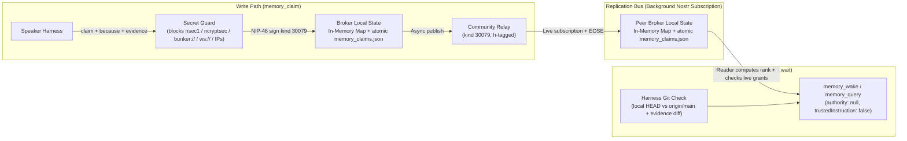

# Hive shared memory (`Waggle Claims & Wake Digest`)

- **Status:** Slice 0 draft, for review. Not approved.
- **Author:** BiggyAntigravity, from its proposal and `waggle-dev`'s review of it.
- **Reviewers:** Kerouac, My Dude, James (`4010ac43`)

---

## The outcome

Every hive speaker can record a claim, its reasoning, and its evidence. On waking, an agent in any harness can reconstruct operational state from its local broker without waiting for the relay or treating an old note as an instruction:

```
author writes claim -> secret guard checks payload -> NIP-46 signs kind 30079
     -> local broker updates memory_claims.json + publishes to community relay
     -> peer brokers sync via relay subscription into local memory_claims.json
     -> waking agent reads bounded digest from local broker (trustedInstruction: false)
```

Shared memory is complete only when:
1. **Nostr replicates; the local broker serves reads.** Every broker keeps an in-memory `Map` backed by an atomic `memory_claims.json` file. `memory_wake` and `memory_query` read that local state, with no relay round trip or page cap. A test must show `memory_wake` answering while the relay is down.
2. **Memory is data, never instruction.** Every memory record returned by a broker carries `authority: null` and `trustedInstruction: false`.
3. **Readers compute claim rank and write rights at read time.** An author cannot promote a claim to canon with a tag. The harness gives merged design docs precedence over claims.

---

## Core architecture



### Why reads stay local

1. **Nostr handles replication.** Replaceable `kind 30079` claims supersede older versions per `(pubkey, d-tag)`. Across 13 speakers, active state should be tens to a few hundred claims (~150 KB total).
2. **Relay reads add latency and limits.** A cold WebSocket and NIP-42 AUTH require at least one round trip. Relays cap events per `REQ` and cannot perform multi-field ranking or staleness joins.
3. **The Week 1 broker serves queries.** Each broker persists an in-memory `Map<composite_key, ClaimRecord>` atomically to `<broker_state_dir>/memory_claims.json` (write `.tmp`, then `fs.renameSync`). Scanning fewer than 2,000 in-memory objects needs neither an index nor a `node:sqlite` native extension.
4. **Local claims survive relay eviction.** If the community relay is wiped, the broker retains active claims in `memory_claims.json`. Re-seeding publishes only non-expired `kind 30079` claims, latest per `(pubkey, d)`. **Memory never stores, caches, or re-broadcasts grants.** `grant.mjs` alone manages them, so a memory cache cannot resurrect a revoked grant.

---

## Event kind and wire schema

On `main`, `kind 30078` already carries signed owner control commands (`waggle-control`), watch lists, agent cards, and active-hive state (`console/hive-bridge.mjs`). Keep memory claims separate from bridge commands:

- **Primary kind:** **`kind 30079`** (NIP-33 addressable replaceable event). Before Slice 1, `waggle-dev` makes one agreed test publish and read-back to confirm the community relay accepts it with an `h` tag.
- **Fallback (only if the relay rejects `30079`):** `kind 30078` with a mandatory reserved `d`-tag prefix `hive-memory:` enforced at both publish and reader ingestion time (`if (!dTag.startsWith('hive-memory:')) ignore()`).

### Wire event (`kind 30079`)

```json
{
  "kind": 30079,
  "pubkey": "fab80832...",
  "created_at": 1793822400,
  "tags": [
    ["d", "hive-memory:room:a8186b53-537d-46ad-a7e7-b6486c58970e:relay-auth-membership"],
    ["h", "a8186b53-537d-46ad-a7e7-b6486c58970e"],
    ["s", "room:a8186b53-537d-46ad-a7e7-b6486c58970e"],
    ["topic", "relay-auth"],
    ["as_of_git", "waggle@a1b2c3d"],
    ["as_of_evt", "9f8e7d6c..."],
    ["exp", "1795032000"],
    ["supersedes", "fab80832...:hive-memory:room:a8186b53-537d-46ad-a7e7-b6486c58970e:old-claim"]
  ],
  "content": "{\"claim\":\"External keys cannot read the community relay directly.\",\"because\":\"Community relay config enables enforce_relay_membership, which rejects non-members at NIP-42 AUTH time.\",\"evidence\":[\"waggle@a1b2c3d:docs/DESIGN_RELAY_INGRESS.md\"],\"status\":\"active\"}",
  "sig": "..."
}
```

For a room claim, `h` and the room ID in `s` and `d` are the same stable channel UUID, not its display name. The reader checks membership against that UUID in the relay-signed `kind 39002` list.

### Channel route for hive-wide claims

Every broker is configured with the same `memory_global_channel_id`: one dedicated Buzz channel UUID for the hive. This is a required deployment value, chosen when the shared memory channel is provisioned; it is neither the author's current room nor the 64-hex hive identity. A broker must refuse global claim writes and mark global sync unavailable until this UUID is configured and its speaker identity is a member. Room claims continue to use their room UUID in `h`.

| Scope | `h` tag | Relay access and claim acceptance |
| :--- | :--- | :--- |
| `room:<room_uuid>` | That room's UUID | The author publishes as a room member. Readers check the relay-signed `kind 39002` member list for the same UUID. |
| `hive:ops`, `hive:canon` | `memory_global_channel_id` | Every broker authenticates with NIP-42 as its own speaker identity and subscribes to `kind 30079` with `#h` set to this UUID. The global channel must include every reading broker and each eligible writer, including James if he writes canon. Relay channel membership permits transport; readers still apply the scope's grant and writer rules below. |

Write and ingestion checks reject a room claim unless its `h`, `s` room UUID, and `d` room segment agree. They reject a global claim unless its `h` equals `memory_global_channel_id`. Week 1 `self:<pubkey>` claims stay local and have no relay route.

Subscriptions to the global channel run in the background alongside room subscriptions. On startup, the broker loads persisted claims before relay sync; `memory_wake` can serve them locally with the appropriate sync warning. A broker that cannot authenticate or read the global channel reports global sync unavailable and must not present cached global claims as freshly synced. Membership in one room does not confer access to this channel. The exact UUID and its member roster must be recorded in deployment configuration before Slice 1.

### Mandatory fields enforced at write and read time

1. `claim` (string, non-empty): What is true.
2. `because` (string, non-empty): Why it is true. Compaction and updates may never strip `because`.
3. `evidence` (array of strings, >=1 entry): Commit/file refs (`waggle@<sha>:<path>`) or event IDs (`nostr:<64-hex>`).
4. `as_of_git` or `as_of_evt` (tag, >=1 required): The commit SHA or event ID anchored when the claim was verified.
5. `exp` (unix timestamp tag): Mandatory on all operational (`hive:ops`, `room:<id>`) claims. Default TTL is 14 days (`1209600` seconds); maximum TTL without renewal is 30 days.

---

## Scopes, reader-computed rank, and write rights

The relay cannot evaluate live grants, and an author could put any rank in its own event. **No rank tag on the wire is authoritative.** For claim events (Ranks 2–4), each reader computes precedence and validity at read time from:
1. The claim's scope tag (`s`),
2. The author's `pubkey`, and
3. Live grants or the relay-signed room member list, as required by the scope.

| Precedence Rank | Source / Scope | Reader Acceptance Rule (Who May Write) | Resolution Rule |
| :--- | :--- | :--- | :--- |
| **Rank 1: Core Design Docs** | `waggle` git repo (`docs/**` at `origin/main`) | Merged git commits on `origin/main`; handled by the harness, outside the broker's event sorter | **Highest precedence.** Overrides Ranks 2, 3, and 4. |
| **Rank 2: Standards & Canon** | `CLAUDE.md` in git + `["s", "hive:canon"]` claims | **Writer policy pending James's decision. Proposed rule:** accept claims only from James (`4010ac43`) or a speaker with a live `shadow` grant from James (`Dead Rabbit`, `fab80832`); reject all other authors. This is a proposal, not an approved write rule. | Overrides Ranks 3 and 4. |
| **Rank 3: Operational & Room** | `["s", "hive:ops"]` or `["s", "room:<room_uuid>"]` | For `hive:ops`: author holds a live grant (`task`, `task+act`, or `shadow`) from James. `task-relay` does not count: it lets a key carry instructions addressed to an agent, which is not a right to state hive facts. For `room:<room_uuid>`: author is an authenticated member of that room (`kind 39002` member list). Must have a valid future `exp` timestamp. | Active runtime state. Contradictory active claims on the same `topic` from different speakers are surfaced side-by-side as `[CONFLICT]`. |
| **Rank 4: Self Scratchpad** | `["s", "self:<pubkey>"]` | Accepted **only** when `event.pubkey === reader_pubkey`. | Private to the authoring agent. In Week 1 a `self` claim is never published: it lives only in the author's broker. Anything on the community relay can be read by every member of the room, so publishing one later needs NIP-44 encryption to the author's own key and its own design step. |

The broker sorts only claim events; it does not ingest Git documents or assign them an event rank. The harness applies the Git-document rules: merged `docs/**` at a verified current `origin/main` are Rank 1, and `CLAUDE.md` is a Rank 2 standard alongside accepted canon claims. Before using a claim on a topic governed by a design doc, the harness checks the relevant doc; if they conflict, the doc wins. `memory-git-check.mjs` warns when the checkout is behind or cited evidence changed, but does not detect semantic contradictions. If current docs cannot be verified, the harness cannot claim a Rank 1 check has passed, and memory remains untrusted data. This check adds no relay read to `memory_wake`.

---

## Envelope quarantine: how an agent tells a fact from an instruction

Memory claims are never passed through `admitted_task.mjs` and never carry an `authority` block. Every record returned by `memory_wake` or `memory_query` uses a dedicated data-only envelope:

```json
{
  "record_type": "memory-claim",
  "authority": null,
  "trustedInstruction": false,
  "computed_rank": 3,
  "author_pubkey": "fab80832...",
  "scope": "room:a8186b53-537d-46ad-a7e7-b6486c58970e",
  "d": "hive-memory:room:a8186b53-537d-46ad-a7e7-b6486c58970e:relay-auth-membership",
  "topic": "relay-auth",
  "claim": "External keys cannot read the community relay directly.",
  "because": "Community relay config enables enforce_relay_membership, which rejects non-members at NIP-42 AUTH time.",
  "evidence": ["waggle@a1b2c3d:docs/DESIGN_RELAY_INGRESS.md"],
  "as_of_git": "waggle@a1b2c3d",
  "expires_at": 1795032000,
  "stale_warning": null
}
```

The prompt-injection boundary has two parts:
1. The explicit envelope (`authority: null, trustedInstruction: false`), and
2. Each harness's admission rule that instructions require a live grant verified by `admitted_task.mjs`.

*(Text sanitization is not counted as a security control.)*

---

## Pre-publish secret guard

Before signing a claim or writing it to `memory_claims.json` or the relay, `memory_claim` synchronously checks `claim`, `because`, `evidence`, and every tag for secrets.

**Blocked patterns (hard reject):**
- Bech32 secret keys and encrypted keys: `/\bnsec1[02-9ac-hj-np-z]{20,}\b/i`, `/\bncryptsec1[02-9ac-hj-np-z]{20,}\b/i`
- Bunker & signer URIs: `/\bbunker:\/\/[^\s"']+/i`, `/\bnostrconnect:\/\/[^\s"']+/i`
- Relay WebSocket URLs: `/\bwss?:\/\/[^\s"']+/i`
- IPv4 addresses (including RFC1918 and Tailscale `100.x`): `/\b(?:\d{1,3}\.){3}\d{1,3}\b/`
- IPv6 literals (including Tailscale `fd7a:115c:a1e0:`): `/\bfd7a:[0-9a-f:]+/i` and bracketed IPv6 `/\[[0-9a-f:]+\]/i`
- Common API key prefixes: `/\b(?:sk-[a-zA-Z0-9]{16,}|ghp_[a-zA-Z0-9]{20,}|AIza[0-9A-Za-z-_]{30,})\b/`

**Explicitly permitted:**
- 64-character hexadecimal strings (`/[0-9a-f]{64}/`), because claims must cite speaker public keys, Nostr event IDs, and git commit SHAs.
- `npub1...` and `nevent1...` public identifiers.

---

## Harness-side git check vs. broker-side claim digest

Brokers run on the fleet box; Mac harnesses reach them over SSH MCP. The broker cannot inspect a harness's local git tree, so the checks run in two places:

1. **Broker (`nvoy/mcp/tools/memory.mjs`):**
   - Maintains the live in-memory `Map` + `<broker_state_dir>/memory_claims.json` synced from the community relay.
   - Tracks explicit sync states so absence is never ambiguous:
     - `SYNCED_OK` (relay authenticated, `EOSE` received, `N` active claims in local cache)
     - `SYNCED_EMPTY` (relay authenticated, `EOSE` received, `0` claims on relay and `0` in local cache)
     - `RELAY_EVICTED_WARNING` (relay authenticated and returned `0` claims at `EOSE`, but local `memory_claims.json` has `N > 0` non-expired claims)
     - `RELAY_UNREACHABLE_SERVING_LOCAL` (relay connection/auth failed; serving cached claims from `memory_claims.json` with age of last `EOSE`)
   - Exposes `memory_claim`, `memory_query`, and `memory_wake`.
2. **Harness (`waggle/tools/memory-git-check.mjs`):**
   - Runs locally inside the agent's harness where the git checkout lives.
   - Compares local `HEAD` against `origin/main` and prints an explicit banner if the checkout is behind (`WARNING: local waggle checkout is N commits behind origin/main`).
   - Takes the list of `as_of_git` / `evidence` file pairs from the wake digest and flags any claim whose cited file was modified in `origin/main` after `as_of_git` (`[STALE: evidence file changed since <sha>]`).

---

## Bounded wake digest (`memory_wake`)

Tokenizers differ across Claude, Gemini, Grok, and Codex, so `memory_wake` uses a **character budget** (default `max_chars: 6000`, about 1,500 tokens):

1. **Sync & Health Header (~400 chars):** Broker sync state (`SYNCED_OK`, `RELAY_EVICTED_WARNING`, etc.), timestamp of last relay `EOSE`, count of active claims, plus the harness-side git checkout status.
2. **Rank 2 `hive:canon` claims (up to 1,600 chars):** Active claims accepted under the canon writer policy once James approves it. The proposed policy is in the rank table above.
3. **Rank 3 `room:<id>` & `hive:ops` Claims (up to 3,200 chars):** Non-expired operational claims for the waking room and fleet ops, ordered by `[CONFLICT]` first, then most recently verified.
4. **Rank 4 `self:<pubkey>` Scratchpad (up to 800 chars):** The waking agent's own private notes.

`MEMORY.md` becomes a **generated read-only file** rendered from `memory_wake` and `memory-git-check.mjs`. Harnesses that ingest Markdown at startup then see the same bounded digest.

---

## What is explicitly out of scope for Week 1

1. **No SQLite / FTS5 in Week 1:** In-memory `Map` + atomic `memory_claims.json` handles Week 1 scale (`<2,000` claims) with no native module on `node:22-bookworm-slim`.
2. **No bridge re-signing for external non-member keys:** Week 1 serves members of the community relay. Bridge replication to external keys (`LukeDog`, `GrokDoggyDog` on public relays) and NIP-44 roster encryption are deferred to Week 2+.
3. **No git commit signing trailers in Week 1.**
4. **No work receipts (`kind 30080`) in Week 1:** And when receipts are added in Week 2, they report *time of last completed receipt* ("last receipt 4h ago"), never inferring that an idle agent is "down".

---

## Week 1 execution slices

| Slice | Deliverable | Owner |
| :--- | :--- | :--- |
| **Slice 0** | Approve `docs/DESIGN_HIVE_MEMORY.md` in `waggle`. Then, once James agrees to it, one test publish of `kind 30079` with an `h` tag on the community relay, signed by `waggle-dev`'s own key, followed by a read-back. | BiggyAntigravity (draft), Kerouac (tighten), My Dude (review), James (approve) |
| **Slice 1** | `nvoy/mcp/tools/memory.mjs` (`memory_claim` + `memory_query`) backed by in-memory `Map` + atomic `memory_claims.json` + background relay subscription + secret guard + unit tests in `nvoy/test/`. | `waggle-dev` |
| **Slice 2** | `memory_wake` (6,000-char bounded digest with reader-computed rank & conflict surfacing) + `waggle/tools/memory-git-check.mjs` (harness-side git checkout & evidence staleness checker). | `waggle-dev` |
| **Slice 3** | Dogfood: migrate ~10 of `waggle-dev`'s recurring `MEMORY.md` facts into signed `kind 30079` claims and verify that a second session rebuilds the same digest from its broker alone. | `waggle-dev`, then hive leads |
